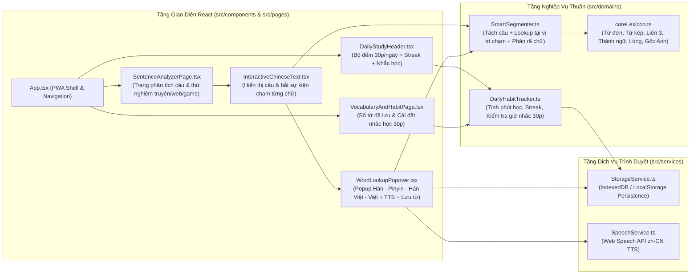

# Solution Architecture — EPIC-01: Nền tảng PWA, Lưu trữ Offline, Bộ Tách Từ & Từ Điển Thông Minh

* **Mã Epic:** EPIC-01
* **Tên Epic:** Foundation, Core Storage, Smart Dictionary Engine & App Shell
* **Trạng thái:** Chờ duyệt (Pending User Review)
* **Liên kết Tài liệu:** [BR-EPIC-01](file:///Users/sakutara/Work/chinese-study/docs/epics/epic-1-foundation-and-core/BR-EPIC-01.md) | [BR-MASTER](file:///Users/sakutara/Work/chinese-study/docs/BR-MASTER.md) | [SA-MASTER](file:///Users/sakutara/Work/chinese-study/docs/SA-MASTER.md)
* **ADRs Áp dụng:** [ADR-001](file:///Users/sakutara/Work/chinese-study/docs/adr/ADR-001-tech-stack-and-pwa-architecture.md), [ADR-002](file:///Users/sakutara/Work/chinese-study/docs/adr/ADR-002-offline-storage-and-dictionary-engine.md), [ADR-003](file:///Users/sakutara/Work/chinese-study/docs/adr/ADR-003-testing-and-90-percent-coverage-gate.md), [ADR-004](file:///Users/sakutara/Work/chinese-study/docs/adr/ADR-004-simplified-first-script-abstraction.md)

---

## 1. Sơ đồ Kiến trúc Thành phần của EPIC-01 (Component Architecture)



---

## 2. Thiết kế Chi tiết các Module Kỹ thuật

### 2.1 Module Từ Điển & Tách Từ Ngữ Cảnh (`src/domains/dictionary/`)

#### A. Cấu trúc Dữ liệu (`types.ts`)
```ts
export type WordCategory =
  | 'core'      // Từ cơ bản (vd: 看, 听, 世界)
  | 'compound'  // Từ ghép 2-3 chữ (vd: 注册, 修炼, 读卡器, 打酱油)
  | 'idiom'     // Thành ngữ 4 chữ (vd: 莫名其妙, 一本正经)
  | 'slang'     // Tiếng lóng mạng (vd: 破防, 破防了, 吃瓜, 666)
  | 'gaming'    // Thuật ngữ game / truyện mạng (vd: 氪金, 肝, 开挂, 满级, 副本)
  | 'loanword'; // Từ gốc tiếng Anh (vd: 卡 card, 注册 register, 寄存器 register, 秀 show, 粉丝 fans, 酷 cool, 派对/趴 party, 艾特 @, 拉黑 block)

export interface DictionaryEntry {
  simplified: string;
  traditional?: string;
  pinyin: string;
  hanViet: string;
  meanings: string[];
  category: WordCategory;
  englishOrigin?: string;
  example?: {
    zh: string;
    pinyin: string;
    vi: string;
  };
  priority?: number; // Ưu tiên khi trùng độ dài
}

export interface SegmentedToken {
  text: string;
  startIndex: number;
  endIndex: number; // exclusive
  isChineseOrAlnum: boolean;
  entry?: DictionaryEntry;
  constituents: DictionaryEntry[]; // Các chữ đơn hoặc từ con bên trong cụm từ
}
```

#### B. Thuật toán Tách Câu & Tra Từ Tại Điểm Chạm (`SmartSegmenter.ts`)
1. **`segmentSentence(sentence: string): SegmentedToken[]`**
   * Duyệt qua chuỗi đầu vào tại vị trí `i = 0 .. sentence.length - 1`.
   * Nếu ký tự tại `i` là dấu câu hoặc khoảng trắng, tạo token dấu câu và tăng `i`.
   * Ngược lại, thử khớp từ dài nhất trong từ điển từ độ dài `maxWordLen` (8) giảm dần về `1`:
     * Nếu tìm thấy mục từ khớp `sentence.slice(i, i + len)`:
       * Trích xuất `constituents` (từng chữ Hán cấu thành cụm đó có trong từ điển) để phục vụ giải nghĩa sâu.
       * Tạo `SegmentedToken` có `startIndex = i`, `endIndex = i + len`, rồi nhảy `i += len`.
     * Nếu không khớp từ ghép nào, trả về token 1 ký tự tại `i` (tra nghĩa chữ đơn hoặc giữ nguyên ký tự nếu ngoài từ điển).
2. **`lookupAtPosition(sentence: string, charIndex: number): SegmentedToken | null`**
   * Khi người dùng chạm vào một ký tự bất kỳ tại `charIndex` (ví dụ chạm vào chữ `"册"` ở vị trí 3 trong câu `"请先注册账号"` hoặc chạm vào chữ `"酱"` trong `"打酱油"`):
   * Paso 1: Chạy `segmentSentence(sentence)` và tìm token chứa `charIndex` (`token.startIndex <= charIndex < token.endIndex`).
   * Paso 2: Kiểm tra thêm cửa sổ lân cận bao quanh `charIndex` để xem có cụm từ dài hơn bị chồng lấp ranh giới hay không; nếu có cụm từ dài hơn trong từ điển chứa `charIndex`, ưu tiên trả về cụm dài nhất đó kèm `constituents`.

### 2.2 Module Theo dõi 30 Phút/Ngày & Nhắc Học (`src/domains/tracker/DailyHabitTracker.ts`)
* **Dữ liệu trạng thái (`StudyHabitState`):**
  ```ts
  export interface DailyStudyRecord {
    date: string;           // Định dạng YYYY-MM-DD theo giờ địa phương
    secondsStudied: number; // Tổng số giây đã học trong ngày
    goalCompleted: boolean; // true nếu secondsStudied >= dailyGoalMinutes * 60
  }

  export interface HabitSettings {
    dailyGoalMinutes: number; // Mặc định: 30 phút
    reminderEnabled: boolean; // Mặc định: true
    reminderTime: string;     // Định dạng "HH:mm", mặc định "20:00"
    scriptMode: 'simplified' | 'traditional'; // Mặc định 'simplified'
  }
  ```
* **Các hàm nghiệp vụ thuần:**
  * `recordStudySeconds(records, dateStr, addedSeconds, goalMinutes)`: Cộng dồn số giây học trong ngày `dateStr`, tự động đánh dấu `goalCompleted = true` khi đạt $\ge 1800$ giây (30 phút).
  * `calculateStreak(records, todayDateStr)`: Tính chuỗi ngày liên tiếp đạt mục tiêu (hoặc có học tập).
  * `shouldTriggerDailyReminder(recordToday, settings, currentTimeHHMM)`: Trả về `true` nếu `settings.reminderEnabled === true`, `currentTimeHHMM >= settings.reminderTime` và số giây học hôm nay chưa đủ `dailyGoalMinutes * 60`.

### 2.3 Dịch vụ Lưu trữ Offline & Phát âm (`src/services/`)
* **`StorageService.ts`:**
  * Cung cấp API đồng bộ/bất đồng bộ để đọc và ghi:
    * `getSavedWords()` / `toggleSaveWord(entry)`
    * `getStudyRecords()` / `saveStudyRecords(records)`
    * `getHabitSettings()` / `saveHabitSettings(settings)`
  * Sử dụng `localStorage` kết hợp bộ nhớ đệm và IndexedDB store để vừa hoạt động offline bền vững, vừa dễ dàng đạt 100% test coverage trong môi trường Vitest.
* **`SpeechService.ts`:**
  * Bọc `window.speechSynthesis` để phát âm câu/từ tiếng Hoa với giọng `zh-CN` (tốc độ mặc định `0.9` cho người học nghe rõ thanh điệu), tự động xử lý an toàn khi trình duyệt không hỗ trợ TTS.

---

## 3. Kế hoạch Kiểm thử & Ma trận Độ phủ ($\ge 90\%$ Coverage Plan)

| File Kiểm thử | Đối tượng được kiểm thử | Kịch bản kiểm thử chính (Test Cases) |
| :--- | :--- | :--- |
| `tests/smartSegmenter.test.ts` | `SmartSegmenter` & `coreLexicon` | - Tách câu có từ đơn, từ kép (`注册`, `修炼`), từ liên 3 (`打酱油`, `破防了`, `读卡器`), thành ngữ 4 chữ (`莫名其妙`).<br>- Nhận diện chính xác tiếng lóng (`氪金`, `肝`, `吃瓜`, `开挂`) và từ gốc Anh (`卡` card, `注册` register, `寄存器` register, `秀` show, `粉丝` fans, `酷` cool, `派对` party, `艾特` @, `拉黑` block).<br>- Chạm vào ký tự giữa/cuối cụm từ (`lookupAtPosition`) vẫn trả về đúng cả cụm từ ghép kèm danh sách chữ thành phần (`constituents`).<br>- Xử lý câu rỗng, dấu câu tiếng Trung (`，。！？`), ký tự ngoài từ điển. |
| `tests/dailyHabitTracker.test.ts` | `DailyHabitTracker` | - Cộng dồn thời gian học và tự động chuyển `goalCompleted = true` khi chạm mốc 30 phút (1800s).<br>- Tính toán `Streak` chính xác qua nhiều ngày liên tiếp và khi bị đứt quãng.<br>- Kiểm tra logic nhắc học `shouldTriggerDailyReminder` trước giờ nhắc, đúng giờ nhắc khi chưa đủ 30p, và khi đã đủ 30p. |
| `tests/storageAndSpeech.test.ts` | `StorageService` & `SpeechService` | - Lưu/xóa từ vựng trong Sổ từ offline, đọc/ghi cài đặt nhắc học và lịch sử học tập.<br>- Xử lý fallback an toàn khi dữ liệu JSON lỗi.<br>- Gọi phát âm `SpeechService.speak()` khi có `speechSynthesis` và khi môi trường không hỗ trợ. |
| `tests/appIntegration.test.tsx` | `App`, `InteractiveChineseText`, `WordLookupPopover`, `DailyStudyHeader` | - Render toàn bộ SPA, chuyển tab điều hướng.<br>- Click vào chữ trong câu tiếng Hoa $\rightarrow$ mở Popover hiển thị Hán, Pinyin, Hán-Việt, Việt, gốc tiếng Anh, chữ thành phần.<br>- Bấm nút Nghe phát âm và Lưu từ vào sổ từ $\rightarrow$ kiểm tra từ xuất hiện trong tab Sổ từ.<br>- Bấm nút cộng thời gian học / chạy bộ đếm giờ và thay đổi giờ nhắc học 30p/ngày. |

---

## 4. Cấu hình Triển khai GitHub Pages (`.github/workflows/deploy.yml`)
* Sử dụng GitHub Actions chạy trên sự kiện `push` vào nhánh `main`:
  1. `npm ci`
  2. `npm run test:coverage` (Cổng chặn cứng: phải đạt $\ge 90\%$ mới cho phép đi tiếp)
  3. `npm run build` (Tạo bản build PWA tĩnh trong `dist/` với `base: './'`)
  4. Deploy `dist/` lên GitHub Pages bằng `actions/upload-pages-artifact` và `actions/deploy-pages`.
