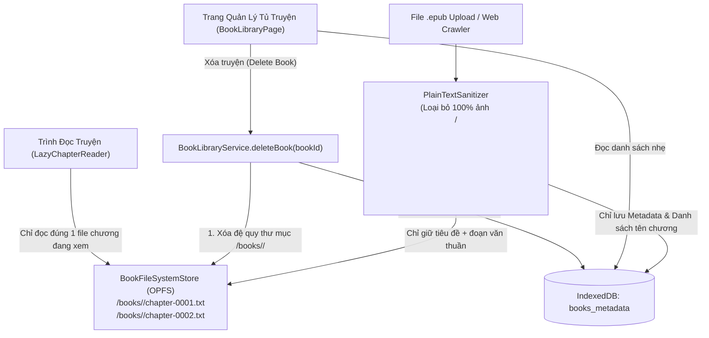

# Solution Architecture — EPIC-04: Upload EPUB Tinh Giản, Đọc Truyện Lazy-Load Theo Chương & Quản Lý Tủ Truyện

* **Mã Epic:** EPIC-04
* **Tên Epic:** Plain-Text EPUB Upload, Lazy-Loaded Chapter Reader & Book Library Manager
* **Trạng thái:** Chờ duyệt (Pending User Review)
* **Liên kết Tài liệu:** [BR-EPIC-04](file:///Users/sakutara/Work/chinese-study/docs/epics/epic-4-epub-reader/BR-EPIC-04.md) | [SA-MASTER](file:///Users/sakutara/Work/chinese-study/docs/SA-MASTER.md) | [ADR-006](file:///Users/sakutara/Work/chinese-study/docs/adr/ADR-006-opfs-chapter-file-storage-and-background-novel-translator.md)

---

## 1. Sơ đồ Kiến trúc Lưu Trữ File Theo Thư Mục & Lazy-Load Chương



---

## 2. Thiết kế Chi tiết các Module Kỹ thuật

### 2.1 Bộ Lọc Tinh Giản Văn Bản Thuần (`src/domains/epub/PlainTextSanitizer.ts`)
* **`sanitizeHtmlToPlainText(rawHtml: string): { title?: string; paragraphs: string[] }`**
  * Loại bỏ hoàn toàn các khối `<script>`, `<style>`, `<svg>`, `<head>`, `<nav>`, `<figure>`, ``, `<picture>`, `<video>`, `<audio>`, `<iframe>`.
  * Chuyển các thẻ ngắt đoạn (`</p>`, `<br>`, `<br/>`, `</div>`, `</h1>`, `</h2>`, `</h3>`) thành ký tự xuống dòng `\n`.
  * Loại bỏ toàn bộ các thẻ HTML còn lại và giải mã các thực thể HTML (`&nbsp;`, `&amp;`, `&lt;`, `&gt;`, `&quot;`).
  * Lọc bỏ các dòng trống hoặc dòng rác quảng cáo, trả về mảng `paragraphs: string[]` chỉ chứa văn bản thuần túy.

### 2.2 Lưu Trữ File Theo Thư Mục Truyện (`src/services/storage/BookFileSystemStore.ts`)
* Giao diện lưu trữ file trừu tượng hóa trên **OPFS (`navigator.storage.getDirectory()`)** kèm `InMemoryFileSystemBackend` để chạy mượt trên mọi trình duyệt và đạt 100% độ phủ kiểm thử:
  ```ts
  export interface ChapterFileContent {
    index: number;
    title: string;
    paragraphs: string[];
  }

  export interface IBookFileSystemStore {
    writeChapterFile(bookId: string, chapter: ChapterFileContent): Promise<string>; // Trả về đường dẫn "/books/<bookId>/chapter-0001.txt"
    readChapterFile(bookId: string, chapterIndex: number): Promise<ChapterFileContent | null>;
    listChapterFiles(bookId: string): Promise<string[]>;
    deleteBookDirectory(bookId: string): Promise<boolean>; // Xóa sạch thư mục "/books/<bookId>" và toàn bộ file chương
  }
  ```
* **Định dạng file chương trên đĩa (`/books/<bookId>/chapter-0001.txt`):**
  * Dòng 1: `# <Tiêu đề chương thuần>`
  * Từ dòng 2 trở đi: Từng đoạn văn bản thuần cách nhau bởi ký tự xuống dòng `\n`.

### 2.3 Bộ Nhập File `.epub` Tinh Giản (`src/domains/epub/EpubPlainImporter.ts`)
* Đọc file `.epub` qua `JSZip.loadAsync(buffer)`.
* Đọc `META-INF/container.xml` $\rightarrow$ tìm đường dẫn `.opf` $\rightarrow$ đọc `<metadata>` (lấy `dc:title`, `dc:creator`) và thứ tự đọc trong `<spine>` / `<manifest>`.
* **Quy tắc bỏ qua tài nguyên nặng:** Chỉ duyệt các mục trong `<spine>` có `media-type="application/xhtml+xml"` hoặc `"text/html"`. **Không bao giờ giải nén** các file ảnh hay font trong gói ZIP vào bộ nhớ.
* Với từng chương trong `<spine>`, giải nén nội dung chữ của chương đó, đưa qua `PlainTextSanitizer.sanitizeHtmlToPlainText()`, ghi ngay ra file `/books/<bookId>/chapter-XXXX.txt` qua `BookFileSystemStore.writeChapterFile()`, rồi giải phóng bộ nhớ trước khi chuyển sang chương kế tiếp.

### 2.4 Dịch vụ Quản lý Danh sách Truyện & Xóa Truyện (`src/domains/epub/BookLibraryService.ts`)
* **`listAllBooks()`**: Trả về danh sách `BookMetadata[]` từ DB (không đọc bất kỳ file nội dung chương nào nên tốc độ phản hồi $< 2\text{ms}$).
* **`deleteBookCompletely(bookId: string)`**:
  1. Hủy/xóa mọi `CrawlJob` và `TranslationJob` liên quan đến `bookId`.
  2. Gọi `BookFileSystemStore.deleteBookDirectory(bookId)` để xóa toàn bộ thư mục `/books/<bookId>/` và tất cả các file chương bên trong.
  3. Xóa `BookMetadata` của `bookId` khỏi DB.

---

## 3. Kế hoạch Kiểm thử & Ma trận Độ phủ ($\ge 90\%$ Coverage Plan)

| File Kiểm thử | Đối tượng được kiểm thử | Kịch bản kiểm thử chính (Test Cases) |
| :--- | :--- | :--- |
| `tests/plainTextSanitizer.test.ts` | `PlainTextSanitizer` | - Xóa sạch thẻ ``, `<svg>`, `<style>`, `class`, `style` inline và chỉ giữ lại văn bản thuần.<br>- Chuẩn hóa ngắt dòng `<p>`, `<br>` thành mảng `paragraphs` sạch. |
| `tests/bookFileSystemStore.test.ts` | `BookFileSystemStore` | - Tạo thư mục `/books/<bookId>/` và ghi từng chương thành file `chapter-0001.txt`, `chapter-0002.txt`.<br>- Lazy-load đọc đúng 1 file chương theo `chapterIndex`.<br>- Gọi `deleteBookDirectory(bookId)` $\rightarrow$ xác minh toàn bộ thư mục và tất cả các file chương của truyện đã bị xóa sạch hoàn toàn. |
| `tests/epubImporterAndLibrary.test.ts` | `EpubPlainImporter` & `BookLibraryService` | - Upload gói `.epub` có chứa cả ảnh bìa, CSS và nhiều chương XHTML $\rightarrow$ xác minh ảnh và CSS bị loại bỏ, các chương được lưu thành từng file riêng trong `/books/<bookId>/`.<br>- Xóa truyện qua `deleteBookCompletely` $\rightarrow$ xác minh cả DB metadata lẫn thư mục file đều biến mất. |
