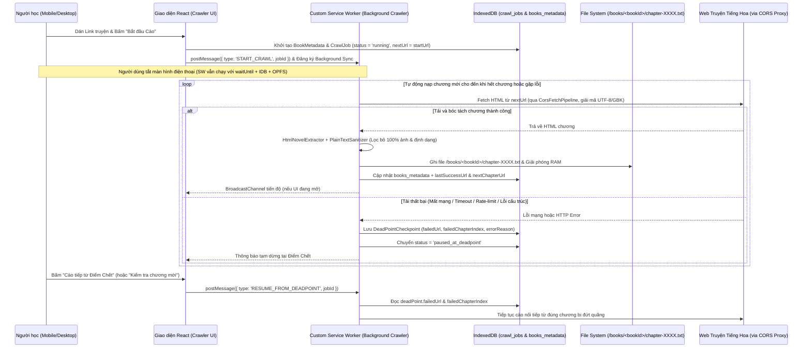
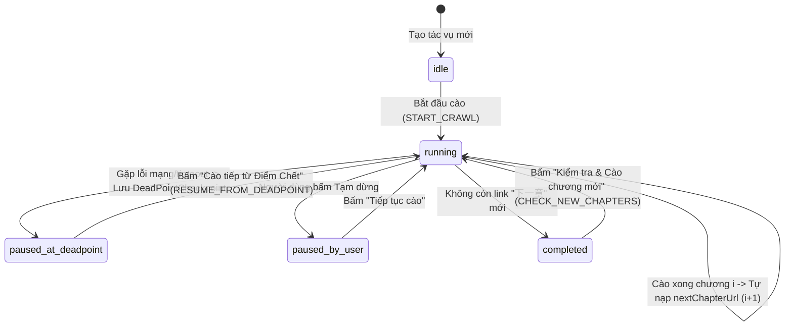

# Solution Architecture — EPIC-05: Tự Động Cào Truyện Online Ngầm (Service Worker), Lưu Điểm Chết & Xuất File EPUB

* **Mã Epic:** EPIC-05
* **Tên Epic:** Service Worker Web Novel Crawler, Dead-Point Resume & EPUB Exporter
* **Trạng thái:** Chờ duyệt (Pending User Review)
* **Liên kết Tài liệu:** [BR-EPIC-05](file:///Users/sakutara/Work/chinese-study/docs/epics/epic-5-novel-crawler-and-epub-export/BR-EPIC-05.md) | [BR-MASTER](file:///Users/sakutara/Work/chinese-study/docs/BR-MASTER.md) | [SA-MASTER](file:///Users/sakutara/Work/chinese-study/docs/SA-MASTER.md)
* **ADRs Áp dụng:** [ADR-001](file:///Users/sakutara/Work/chinese-study/docs/adr/ADR-001-tech-stack-and-pwa-architecture.md), [ADR-002](file:///Users/sakutara/Work/chinese-study/docs/adr/ADR-002-offline-storage-and-dictionary-engine.md), [ADR-003](file:///Users/sakutara/Work/chinese-study/docs/adr/ADR-003-testing-and-90-percent-coverage-gate.md), [ADR-005](file:///Users/sakutara/Work/chinese-study/docs/adr/ADR-005-service-worker-novel-crawler-and-epub-export.md), [ADR-006](file:///Users/sakutara/Work/chinese-study/docs/adr/ADR-006-opfs-chapter-file-storage-and-background-novel-translator.md)

---

## 1. Sơ đồ Luồng Thực thi & Phục hồi Điểm Chết (Sequence & State Diagram)

### 1.1 Luồng Cào Ngầm bằng Service Worker, Ghi File Từng Chương & Lưu Điểm Chết


### 1.2 Sơ đồ Trạng thái của Tiến trình Cào (`CrawlJobStatus`)


---

## 2. Thiết kế Chi tiết các Module Kỹ thuật (`src/domains/crawler/` & `src/domains/epub/`)

### 2.1 Cấu trúc Dữ liệu Cào Truyện & Điểm Chết (`src/domains/crawler/types.ts`)
```ts
export type CrawlJobStatus =
  | 'idle'
  | 'running'
  | 'paused_at_deadpoint'
  | 'paused_by_user'
  | 'completed';

export interface DeadPointCheckpoint {
  failedUrl: string;              // URL chính xác bị lỗi để cào tiếp
  failedChapterIndex: number;     // Thứ tự chương bị lỗi (1-based)
  lastSuccessChapterUrl?: string; // URL chương gần nhất đã lưu vào DB
  errorReason: string;            // Chi tiết lỗi (Network, Timeout, HTTP 403/429/500, ParseFailure)
  failedAt: string;               // Thời điểm xảy ra điểm chết
  retryCount: number;             // Số lần đã thử lại tại điểm chết này
}

export interface CrawledChapter {
  index: number;                  // Thứ tự chương (1, 2, 3...)
  title: string;                  // Tiêu đề chương (vd: "第一章 陨落的天才")
  sourceUrl: string;              // Đường dẫn gốc của chương
  paragraphs: string[];           // Danh sách các đoạn văn chữ Hán đã làm sạch
  crawledAt: string;              // Thời điểm cào xong chương
}

export interface CrawlJob {
  jobId: string;
  bookTitle: string;
  author?: string;
  startUrl: string;
  currentTargetUrl?: string;      // URL chương tiếp theo cần cào
  lastSuccessChapterUrl?: string; // Dùng để dò chương mới khi truyện ra thêm chương
  status: CrawlJobStatus;
  chaptersCrawled: number;
  maxChaptersLimit: number;       // Giới hạn an toàn mỗi đợt (vd: 100 chương/lượt, 0 = không giới hạn)
  deadPoint?: DeadPointCheckpoint;
  updatedAt: string;
}
```

### 2.2 Bộ Bóc Tách Chương & Tự Động Dò Chương Mới (`HtmlNovelExtractor.ts`)
1. **`extractChapterFromHtml(html: string, pageUrl: string): ExtractedChapterResult`**
   * **Nhận diện tiêu đề truyện & tiêu đề chương:**
     * Tìm thẻ `<h1>`, `.bookname h1`, `#nr_title`, `.chapter-title`, hoặc `<title>` để tách tên chương (ví dụ: `"第12章 破防了"`).
   * **Làm sạch và bóc tách nội dung chữ Hán:**
     * Xóa bỏ `<script>`, `<style>`, `<iframe>`, `.ads`, `.bottem`.
     * Ưu tiên các vùng chứa nội dung phổ biến trên web truyện Trung Quốc (`#content`, `#chaptercontent`, `.Readarea`, `.chapter-content`, `<article>`). Nếu trang dùng class lạ, sử dụng thuật toán chấm điểm khối văn bản có **mật độ ký tự chữ Hán (`[\u4e00-\u9fff]`) cao nhất**.
     * Chuyển các thẻ `<br>`, `</p>` thành mảng các đoạn văn `paragraphs: string[]` sạch sẽ.
   * **Tự động phát hiện URL chương tiếp theo (`nextChapterUrl`):**
     * Duyệt các thẻ `<a href="...">` có văn bản khớp với từ khóa chuyển chương tiếp theo: `下一章`, `下一页`, `下章`, `下一节`, `Next` hoặc `rel="next"`.
     * Chuẩn hóa đường dẫn tương đối thành URL tuyệt đối qua `new URL(href, pageUrl).toString()`.
     * Kiểm tra điều kiện kết thúc: Nếu `nextChapterUrl` trỏ về trang mục lục (`index.html`, kết thúc bằng `/`, hoặc trùng với `pageUrl`), đánh dấu `hasNextChapter = false` (đã cào đến chương mới nhất).
2. **`extractTocLinksFromHtml(html: string, tocUrl: string): Array<{ title: string; url: string }>`**
   * Dành cho trường hợp người dùng dán link trang Mục lục (TOC): Tự động thu thập danh sách link các chương và lọc bỏ những chương đã tồn tại trong IndexedDB để chỉ tải các chương mới.

### 2.3 Bộ Điều Phối Cào & Quản Lý Điểm Chết (`NovelCrawlerRunner.ts`)
* Được thiết kế theo nguyên lý **Dependency Injection** (nhận `fetcher`, `storage`, `onProgress`) để chạy dùng chung cả bên trong **Custom Service Worker (`src/sw/custom-sw.ts`)** lẫn khi fallback trên Main Thread, đồng thời đạt $\ge 90\%$ test coverage dễ dàng:
  * **`startOrResumeCrawl(jobId: string)`**:
    * Nếu `job.status === 'paused_at_deadpoint'` và có `job.deadPoint`, tự động lấy `targetUrl = job.deadPoint.failedUrl` và `chapterIndex = job.deadPoint.failedChapterIndex`.
    * Trong vòng lặp cào:
      1. Gọi `CorsFetchPipeline.fetchHtml(targetUrl)` (có tự động giải mã `UTF-8` / `GB18030` và xoay vòng proxy nếu cần).
      2. Gọi `HtmlNovelExtractor.extractChapterFromHtml(html, targetUrl)`.
      3. Lưu ngay chương vừa cào vào `IndexedDB` (`StorageService.appendCrawledChapter(jobId, chapter)`).
      4. Nếu có `nextChapterUrl`, cập nhật `job.currentTargetUrl = nextChapterUrl`, xóa `deadPoint` cũ và tiếp tục sang chương kế tiếp.
      5. Nếu xảy ra bất kỳ ngoại lệ nào (mạng đứt, proxy lỗi, nội dung rỗng), lập tức khởi tạo `DeadPointCheckpoint` với đầy đủ `failedUrl`, `failedChapterIndex`, `lastSuccessChapterUrl`, `errorReason`, lưu vào DB và dừng vòng lặp an toàn ở trạng thái `'paused_at_deadpoint'`.
  * **`checkForNewChapters(jobId: string)`**:
    * Mở lại `job.lastSuccessChapterUrl` (chương cuối cùng đã cào trước đó), tải HTML mới nhất để kiểm tra xem nút `下一章` trên trang đã được tác giả cập nhật link sang chương mới hay chưa. Nếu đã có link chương mới, tự động kích hoạt cào nối tiếp!

### 2.4 Bộ Đóng Gói và Xuất File `.epub` (`src/domains/epub/EpubExporter.ts`)
* Hàm `buildEpubBlobFromBook(book: CrawledBookData): Promise<Blob>` và `generateEpubStructure(book)`:
  * Tạo cấu trúc chuẩn EPUB 2.0.1 / 3.0 bằng `JSZip`:
    1. `mimetype`: nội dung `"application/epub+zip"`, nén `STORE` (không nén theo đúng chuẩn IDPF).
    2. `META-INF/container.xml`: trỏ tới `OEBPS/content.opf`.
    3. `OEBPS/styles.css`: định dạng phông chữ tiếng Hoa rõ đẹp, giãn dòng chuẩn đọc truyện.
    4. `OEBPS/chapter-0001.xhtml` ... `chapter-NNNN.xhtml`: từng chương truyện đã được thoát ký tự đặc biệt XML (`&`, `<`, `>`, `"`, `'`).
    5. `OEBPS/content.opf` & `OEBPS/toc.ncx`: khai báo metadata (tên truyện, tác giả, ngôn ngữ `zh-CN`, nguồn cào) và mục lục chương đầy đủ.
  * Trả về `Blob` kiểu `application/epub+zip` và hỗ trợ hàm `triggerEpubDownload(blob, filename)` để tải file `<bookTitle>.epub` trực tiếp xuống điện thoại/máy tính.

---

## 3. Kế hoạch Kiểm thử & Ma trận Độ phủ ($\ge 90\%$ Coverage Plan)

| File Kiểm thử | Đối tượng được kiểm thử | Kịch bản kiểm thử chính (Test Cases) |
| :--- | :--- | :--- |
| `tests/htmlNovelExtractor.test.ts` | `HtmlNovelExtractor` | - Bóc tách tiêu đề chương, lọc bỏ quảng cáo/`<script>` và tách đoạn văn chữ Hán.<br>- Tự động phát hiện link chương mới (`下一章`, `下一页`, `rel="next"`) và nhận biết khi đã tới chương cuối cùng (link trỏ về mục lục).<br>- Bóc tách danh sách chương từ trang Mục lục (TOC) và lọc ra các chương mới chưa cào. |
| `tests/novelCrawlerRunner.test.ts` | `NovelCrawlerRunner` & `DeadPointCheckpoint` | - Cào liên tiếp nhiều chương tự động qua link `下一章` và lưu từng chương vào DB.<br>- Giả lập lỗi mạng/HTTP 500 ở chương thứ 3 $\rightarrow$ kiểm tra trạng thái chuyển sang `paused_at_deadpoint` và lưu đúng `DeadPointCheckpoint` (`failedUrl`, `failedChapterIndex = 3`, `lastSuccessChapterUrl = chap2`).<br>- Gọi `resumeFromDeadPoint` $\rightarrow$ kiểm tra hệ thống cào tiếp chính xác từ chương 3, nối vào 2 chương cũ và hoàn tất chương 4, 5.<br>- Gọi `checkForNewChapters` khi tác giả đăng thêm chương mới $\rightarrow$ tự động phát hiện và cào thêm chương mới. |
| `tests/epubExporter.test.ts` | `EpubExporter` & `EpubParser` | - Đóng gói bộ truyện đã cào từ DB thành gói `.epub` (ZIP) chứa đầy đủ `mimetype`, `container.xml`, `content.opf`, `toc.ncx`, `chapter-*.xhtml`.<br>- Giải nén ngược lại gói `.epub` vừa xuất bằng `EpubParser` để xác minh tính toàn vẹn 100% (Round-trip test: Crawl $\rightarrow$ Export `.epub` $\rightarrow$ Import `.epub`). |
