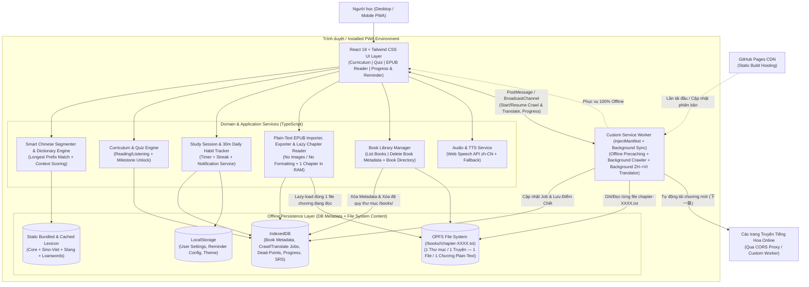

# Master Solution Architecture (SA-MASTER)
**Dự án:** HoaNgữ Đọc-Nghe (Chinese Reading & Listening Webapp)  
**Phiên bản:** 1.0.0  
**Trạng thái:** Baseline (Khởi tạo kiến trúc & Epic 1)  
**Cập nhật lần cuối:** 2026-10-17  

---

## 1. Tổng quan Kiến trúc Hệ thống (System Architecture Overview)
Ứng dụng được thiết kế theo mô hình **Local-First Offline PWA Single Page Application (SPA)**. Toàn bộ xử lý tách từ tiếng Hoa, tra cứu từ điển, chấm điểm bài kiểm tra, quản lý tiến độ học 30 phút/ngày và đọc sách `.epub` đều diễn ra **100% tại trình duyệt của người dùng (Client-side)** mà không cần máy chủ backend.



---

## 2. Công nghệ Sử dụng (Technology Stack)

| Tầng (Layer) | Công nghệ / Thư viện | Lý do lựa chọn (Xem chi tiết trong ADRs) |
| :--- | :--- | :--- |
| **Core Framework** | **React 18 + TypeScript (Strict Mode)** | Hệ sinh thái mạnh, kiểm soát kiểu dữ liệu chặt chẽ, dễ viết unit/integration test độc lập cho từng component. |
| **Build Tool & PWA** | **Vite + `vite-plugin-pwa` (`injectManifest`)** | Biên dịch Custom Service Worker bằng TypeScript: vừa precache tài nguyên offline vừa chạy Background Novel Crawler & Background Novel Translator khi tắt màn hình. |
| **Routing** | **Hash-based SPA Navigation / React Router (`HashRouter`)** | Tương thích tuyệt đối với **GitHub Pages** mà không bị lỗi `404` khi người dùng F5 hoặc mở link trực tiếp khi offline. |
| **Styling** | **Tailwind CSS + Lucide Icons** | Thiết kế giao diện đọc truyện/học tập hiện đại, hỗ trợ chế độ Sáng/Tối/Sepia nhẹ gọn. |
| **File System Storage (Chống ngốn RAM)** | **OPFS (`navigator.storage.getDirectory()`) + Virtual FS Adapter** | Lưu nội dung truyện trên đĩa theo cấu trúc **1 truyện = 1 thư mục (`/books/<bookId>/`)**, **1 chương = 1 file (`chapter-0001.txt`)**. Chỉ đọc đúng 1 file chương lên RAM khi cần, hỗ trợ cả trong Main Thread và Service Worker. |
| **Metadata & Job DB** | **IndexedDB & LocalStorage** | Chỉ lưu Metadata nhẹ của truyện (tiêu đề, ngôn ngữ `zh`/`vi`, mục lục tên chương), tiến độ học 30p/ngày, sổ từ vựng và trạng thái/điểm chết (`DeadPointCheckpoint`) của tiến trình Cào & Dịch. |
| **EPUB Processing & Export** | **JSZip + `PlainTextSanitizer`** | Khi upload `.epub` hoặc cào truyện: loại bỏ 100% hình ảnh và định dạng HTML/CSS, chỉ trích xuất văn bản thuần lưu thành từng file chương. Khi xuất `.epub`: đọc tuần tự từng file chương để đóng gói thành `.epub` tải về máy. |
| **Testing & Coverage** | **Vitest + React Testing Library + `jsdom` + `@vitest/coverage-v8`** | Chạy test cực nhanh và ép ngưỡng coverage $\ge 90\%$ trực tiếp trong `vite.config.ts` mà không cần coverage farm. |
| **CI/CD & Hosting** | **GitHub Actions + GitHub Pages** | Tự động kiểm tra lint, typecheck, test coverage $\ge 90\%$ và deploy bản build tĩnh lên nhánh/environment GitHub Pages. |

---

## 3. Thiết kế Chi tiết các Phân hệ Cốt lõi (Core Module Architecture)

### 3.1 Bộ Tách Từ & Từ Điển Tiếng Hoa Thông Minh (`src/domains/dictionary/`)
Để giải quyết bài toán dịch chạm thông minh cho **từ đơn, từ kép, từ liên 3, thành ngữ 4 chữ, tiếng lóng và từ gốc tiếng Anh** hoàn toàn offline:

1. **Cấu trúc Dữ liệu Từ mục (`DictionaryEntry`):**
   ```ts
   export type WordCategory =
     | 'core'        // Từ vựng phổ thông
     | 'compound'    // Từ ghép 2-3 chữ
     | 'idiom'       // Thành ngữ / cụm 4 chữ
     | 'slang'       // Tiếng lóng mạng / Bilibili / Weibo
     | 'gaming'      // Thuật ngữ game / tiểu thuyết mạng (võng du, tiên hiệp)
     | 'loanword';   // Từ ngoại lai / gốc tiếng Anh (vd: 卡 card, 注册 register, 秀 show, 粉丝 fans)

   export interface DictionaryEntry {
     simplified: string;          // Chữ Hán giản thể (Khóa chính giai đoạn 1)
     traditional?: string;        // Chữ Hán phồn thể (Sẵn sàng cho Epic 7)
     pinyin: string;              // Pinyin có dấu thanh điệu (vd: "pò fáng")
     hanViet: string;             // Âm Hán-Việt (vd: "phá phòng")
     meanings: string[];          // Nghĩa tiếng Việt theo ngữ cảnh
     category: WordCategory;      // Phân loại từ
     englishOrigin?: string;      // Từ tiếng Anh gốc nếu là loanword/tech term (vd: "card", "register")
     examples?: Array<{
       zh: string;
       pinyin: string;
       vi: string;
     }>;
     frequency?: number;          // Trọng số ưu tiên khi tách câu
   }
   ```

2. **Thuật toán Tách Từ & Nhận Diện Ngữ Cảnh (`SmartSegmenter`):**
   * **Cấu trúc chỉ mục (Trie / Prefix Map):** Khi khởi động, dữ liệu từ điển tĩnh được nạp vào cấu trúc bảng băm kết hợp độ dài từ tối đa ($L_{\max} = 8$).
   * **Thuật toán Bi-directional / Longest Prefix Match có Trọng số (Weighted Maximum Forward Matching):**
     * Khi phân tích một câu tiếng Hoa hoặc khi người dùng chạm vào ký tự thứ $i$ trong câu:
     * Bộ phân tích tìm tất cả các ứng viên từ vựng bao phủ vị trí $i$ (hoặc bắt đầu từ vị trí đầu câu đến cuối câu).
     * **Ưu tiên cụm từ dài & có ngữ nghĩa đặc thù:** Từ liên 3 (`打酱油`, `破防了`), thành ngữ 4 chữ (`莫名其妙`), từ kép (`注册`, `读卡器`), tiếng lóng (`氪金`, `吃瓜`) và từ mượn tiếng Anh (`粉丝`, `派对`, `拉黑`, `寄存器`) luôn được ưu tiên gom nhóm trước từ đơn (`卡`, `秀`, `肝`).
     * **Cơ chế phân rã đa tầng (Sub-character Breakdown):** Khi người dùng chạm vào một cụm từ ghép (ví dụ `注册账号` hoặc `破防`), Popover hiển thị nghĩa của cả cụm từ chính **đồng thời** liệt kê nghĩa Hán-Việt và nghĩa tiếng Việt của từng chữ đơn/từ thành phần bên trong để người học hiểu tận gốc cấu tạo từ.

### 3.2 Hệ thống Lưu trữ Tách biệt: Metadata DB & File System Theo Chương (`src/services/storage/`)
Để đảm bảo ứng dụng **không bao giờ bị tràn RAM** dù lưu trữ hàng chục bộ truyện dài hàng nghìn chương:

1. **Hệ thống File theo Thư mục Truyện (`BookFileSystemStore.ts`):**
   * Sử dụng **Origin Private File System (OPFS - `navigator.storage.getDirectory()`)** (kèm adapter dự phòng cho môi trường test):
     * Mỗi bộ truyện (dù là truyện upload `.epub`, truyện cào tiếng Hoa hay truyện dịch tiếng Việt) có một thư mục riêng:
       `/books/<bookId>/`
     * Mỗi chương của bộ truyện được ghi thành **1 file văn bản thuần độc lập**:
       `/books/<bookId>/chapter-0001.txt`, `/books/<bookId>/chapter-0002.txt`, ...
     * Nội dung mỗi file chỉ chứa dòng tiêu đề chương và các đoạn văn bản thuần (`\n`-separated plain text) — **hoàn toàn không lưu ảnh, không lưu thẻ HTML/CSS**.
   * **Các thao tác File System cốt lõi:**
     * `writeChapterFile(bookId, chapterIndex, plainTitle, plainParagraphs)`: Ghi trực tiếp 1 file chương xuống đĩa và giải phóng chuỗi khỏi bộ nhớ.
     * `readChapterFile(bookId, chapterIndex)`: Chỉ đọc đúng 1 file chương khi người dùng mở chương đó trong Reader hoặc khi bộ Dịch/bộ Xuất EPUB xử lý tới chương đó.
     * `deleteBookDirectory(bookId)`: Xóa đệ quy toàn bộ thư mục `/books/<bookId>/` và tất cả các file chương bên trong khi người dùng bấm **"Xóa truyện"**.

2. **Cơ sở dữ liệu Metadata & Tiến trình (`IndexedDB` / `StorageRepository`):**
   * Chỉ lưu dữ liệu cấu trúc gọn nhẹ, không lưu nội dung chương truyện:
     1. `books_metadata`: Lưu `BookMetadata` (`bookId`, `title`, `language: 'zh' | 'vi'`, `originType: 'epub_upload' | 'web_crawl' | 'translated_vi'`, `sourceBookId`, `chapterCount`, `chapterIndexList: Array<{ index, title }>`, `lastReadChapterIndex`).
     2. `crawl_jobs`: Trạng thái cào truyện và **Điểm chết cào truyện (`DeadPointCheckpoint`)**.
     3. `translation_jobs`: Trạng thái dịch truyện (`ZH -> VI`) và **Điểm chết dịch thuật (`TranslationDeadPointCheckpoint`)**.
     4. `user_progress`, `study_sessions`, `saved_words`: Tiến độ bài học, thời gian học 30p/ngày và sổ từ vựng.

3. **Bộ Tinh Giản Văn Bản Thuần (`PlainTextSanitizer.ts`):**
   * Dùng chung cho cả **Upload EPUB** và **Cào Truyện Online**:
   * Loại bỏ hoàn toàn mọi thẻ ``, `<picture>`, `<svg>`, `<canvas>`, `<video>`, `<audio>`, `<style>`, `<script>`, `<iframe>` và bỏ qua toàn bộ file ảnh nhị phân (`.jpg`, `.png`, `.webp`, `.gif`) cũng như file `.css`/font trong gói EPUB.
   * Chuyển đổi các khối đoạn văn thành văn bản thuần sạch sẽ (chuẩn hóa khoảng trắng, ngắt dòng chuẩn giữa các đoạn).

### 3.3 Hệ thống Theo dõi 30 Phút/Ngày & Nhắc Học (`src/domains/tracker/`, `src/domains/srs/`) — chi tiết: [SA-EPIC-03](epics/epic-3-progress-and-reminder/SA-EPIC-03.md)
* **Study Timer Engine:** Tự động đếm thời gian hoạt động khi người dùng tương tác trên trang Bài học, Kiểm tra hoặc Đọc truyện.
* **Daily Reminder Service:**
  * Cho phép bật/tắt nhắc học và chọn giờ nhắc (mặc định `20:00`).
  * Kiểm tra xem hôm nay người dùng đã đạt đủ `30 phút` (1800 giây) hay chưa.
  * Nếu chưa đạt và đã tới giờ nhắc: Hiển thị Banner nhắc nhở nổi bật trong ứng dụng và kích hoạt thông báo hệ thống qua `Notification API`.

### 3.4 Bộ Cào Truyện Online Ngầm bằng Service Worker, Lưu Điểm Chết & Xuất EPUB (`src/domains/crawler/`)
1. **Thực thi trong Service Worker + Ghi File Từng Chương (`ServiceWorkerCrawlerEngine`):**
   * Chạy trong `src/sw/custom-sw.ts` với `ExtendableEvent.waitUntil()` và `Background Sync`.
   * Mỗi khi tải xong 1 chương, lọc qua `PlainTextSanitizer`, ghi ngay thành file `/books/<bookId>/chapter-XXXX.txt` trên OPFS và cập nhật chỉ mục chương vào `books_metadata` trong IndexedDB.
2. **Tự động Dò Chương Mới (`HtmlNovelExtractor`):**
   * Tự động lần theo link `下一章` / `下一页` hoặc đối chiếu trang Mục lục (TOC) để tải tiếp chương mới.
3. **Lưu và Phục hồi từ "Điểm Chết" (`DeadPointCheckpoint`):**
   * Khi lỗi tại chương `k`, lưu `failedUrl`, `failedChapterIndex = k`, `lastSuccessChapterUrl`, `errorReason` vào DB. Khi bấm **"Cào tiếp"**, nối lại đúng từ chương `k`.
4. **Đóng gói & Tải Xuống File `.epub` Từ Thư Mục Chương (`EpubExporter`):**
   * Đọc tuần tự từng file `/books/<bookId>/chapter-XXXX.txt` từ thư mục truyện để đóng gói vào `JSZip` và xuất ra file `<ten-truyen>.epub` văn bản thuần (nhẹ, không chứa ảnh rác).

### 3.5 Bộ Dịch Truyện Chạy Ngầm (Tiếng Hoa $\rightarrow$ Tiếng Việt) & Quản Lý Điểm Chết Dịch Thuật (`src/domains/translator/`)
Để dịch một bộ truyện tiếng Hoa có sẵn trong DB/File System sang một bộ truyện tiếng Việt hoàn chỉnh, chạy ngầm bằng Service Worker và phục hồi sau khi lỗi:

1. **Tạo Bộ Truyện Tiếng Việt Độc Lập có Tiêu Đề Tiếng Việt:**
   * Khi người dùng chọn một bộ truyện tiếng Hoa (`sourceBookId`, ngôn ngữ `'zh'`) và bấm **"Dịch sang Tiếng Việt"**:
   * Hệ thống dịch tiêu đề truyện gốc sang **Tiêu đề tiếng Việt** (ví dụ: `"凡人修仙传"` $\rightarrow$ `"Phàm Nhân Tu Tiên Truyện"`), khởi tạo bản ghi `BookMetadata` mới (`targetBookId`, `language: 'vi'`, `originType: 'translated_vi'`, `sourceBookId`) trong DB và tạo thư mục `/books/<targetBookId>/` trên File System.
2. **Tiến Trình Dịch Từng Chương Chạy Ngầm bằng Service Worker (`NovelTranslationRunner`):**
   * Chạy trong **Custom Service Worker** (hoạt động liên tục kể cả khi tắt màn hình điện thoại):
   * Với mỗi chương $i$, Service Worker chỉ đọc **đúng 1 file chương gốc** `/books/<sourceBookId>/chapter-iiii.txt` lên bộ nhớ, thực hiện dịch tiêu đề chương + nội dung các đoạn văn sang tiếng Việt (hỗ trợ cả **Engine dịch thuật ngữ cảnh Hán-Việt/Thuần Việt Offline thông minh** kết hợp **Online Translation Adapter** có cấu hình). Khi người dùng nhập **Gemini API key** (lưu trong IndexedDB `app_settings`), `GeminiNovelTranslator` dịch theo khối đoạn có ngữ cảnh và bảng thuật ngữ (`TranslationJob.glossary`) để ra văn phong tiếng Việt trau chuốt thay vì ghép nghĩa từng từ; lỗi hạn mức/mạng dừng ở điểm chết. Sau đó ghi kết quả ra file `/books/<targetBookId>/chapter-iiii.txt` và giải phóng RAM ngay lập tức.
3. **Lưu & Nhớ "Điểm Chết" Khi Dịch Lỗi (`TranslationDeadPointCheckpoint`):**
   ```ts
   export interface TranslationDeadPointCheckpoint {
     failedChapterIndex: number;        // Thứ tự chương bị lỗi khi đang dịch
     lastTranslatedChapterIndex: number;// Chương gần nhất đã dịch và ghi file thành công
     errorReason: string;               // Lý do thất bại (Rate limit, Timeout, Network/Parse Error)
     failedAt: string;                  // ISO timestamp
     retryCount: number;
   }
   ```
   * Nếu chương $k$ dịch thất bại, tiến trình dừng an toàn ở trạng thái `'paused_at_deadpoint'` và lưu `TranslationDeadPointCheckpoint` vào `translation_jobs` trong DB.
   * Khi người dùng bấm **"Dịch tiếp từ điểm chết"**, Service Worker đọc tiếp từ file chương $k$ (`failedChapterIndex`), không bao giờ phải dịch lại các chương $1 \dots k-1$ đã lưu trên file.

---

## 4. Cấu trúc Thư mục Dự án (Project Directory Structure)

```text
/Users/sakutara/Work/chinese-study/
├── documents/                                   # Toàn bộ tài liệu dự án
│   ├── BR-MASTER.md                        # Tài liệu Yêu cầu Nghiệp vụ Tổng thể
│   ├── SA-MASTER.md                        # Tài liệu Kiến trúc Giải pháp Tổng thể
│   ├── adr/                                # Architecture Decision Records
│   │   ├── ADR-001-tech-stack-and-pwa-architecture.md
│   │   ├── ADR-002-offline-storage-and-dictionary-engine.md
│   │   ├── ADR-003-testing-and-90-percent-coverage-gate.md
│   │   ├── ADR-004-simplified-first-script-abstraction.md
│   │   ├── ADR-005-service-worker-novel-crawler-and-epub-export.md
│   │   ├── ADR-006-opfs-chapter-file-storage-and-background-novel-translator.md
│   │   └── ADR-007-srs-scheduler-and-progress-analytics.md
│   └── epics/                              # Tài liệu BR & SA theo từng Epic
│       ├── epic-1-foundation-and-core/
│       │   ├── BR-EPIC-01.md
│       │   └── SA-EPIC-01.md
│       ├── epic-3-progress-and-reminder/
│       │   ├── BR-EPIC-03.md
│       │   └── SA-EPIC-03.md
│       ├── epic-4-epub-reader/
│       │   ├── BR-EPIC-04.md
│       │   └── SA-EPIC-04.md
│       ├── epic-5-novel-crawler-and-epub-export/
│       │   ├── BR-EPIC-05.md
│       │   └── SA-EPIC-05.md
│       └── epic-6-novel-translator/
│           ├── BR-EPIC-06.md
│           └── SA-EPIC-06.md
├── public/                                 # Tài nguyên tĩnh (PWA icons, manifest)
├── src/
│   ├── data/                               # Dữ liệu tĩnh: Từ điển, Giáo trình, Truyện mẫu
│   ├── domains/                            # Logic nghiệp vụ thuần (Pure TS, dễ test >95% coverage)
│   │   ├── dictionary/                     # Bộ tách từ thông minh & tra cứu Hán-Pinyin-Hán Việt-Việt
│   │   ├── tracker/                        # Theo dõi 30p/ngày, Streak, Nhắc học
│   │   ├── curriculum/                     # (Epic 2) Giáo trình & Chấm điểm Quiz
│   │   ├── epub/                           # (Epic 4 & 5) Plain-text EPUB Importer/Exporter & Lazy Reader
│   │   ├── crawler/                        # (Epic 5) Bộ bóc tách chương plain-text, dò chương mới & Điểm Chết
│   │   └── translator/                     # (Epic 6) Bộ dịch truyện ZH->VI chạy ngầm & Điểm Chết dịch thuật
│   ├── sw/                                 # Custom Service Worker (Offline cache + Crawler + Translator)
│   ├── services/                           # Giao tiếp trình duyệt (BookFileSystemStore, IndexedDB, TTS, SW Bridge)
│   ├── components/                         # Giao diện React tái sử dụng
│   ├── pages/                              # Các màn hình chính của SPA (bao gồm Trang Quản lý Tủ Truyện)
│   ├── App.tsx                             # App Shell & Điều hướng
│   └── main.tsx                            # Điểm khởi chạy & Đăng ký PWA Service Worker
├── tests/                                  # Bộ kiểm thử Unit & Integration (Vitest)
├── .github/workflows/deploy.yml            # CI/CD: Kiểm tra Coverage >= 90% & Deploy GitHub Pages
├── vite.config.ts                          # Cấu hình Vite, PWA và ngưỡng Coverage 90%
└── package.json
```

---

## 5. Chiến lược Đảm bảo Độ phủ Kiểm thử $\ge 90\%$ (Test Coverage Strategy)
1. **Tách biệt Domain Logic và Browser Side-effects:**
   * Toàn bộ thuật toán tách từ, tra từ điển, tính điểm, tính chuỗi ngày học (Streak), lọc văn bản thuần (`PlainTextSanitizer`), lưu/đọc/xóa thư mục chương truyện (`BookFileSystemStore`), cào truyện (`NovelCrawlerRunner`), dịch truyện (`NovelTranslationRunner`), quản lý Điểm chết (`DeadPointCheckpoint`) và đóng gói/giải nén EPUB được viết dưới dạng hàm/lớp TypeScript thuần (`Pure Functions / Services với Dependency Injection`).
   * Các Web API phụ thuộc môi trường (`navigator.storage.getDirectory`, `window.speechSynthesis`, `Notification`, `IndexedDB`, `ServiceWorkerGlobalScope`) đều có Adapter mỏng và Mock chuẩn trong bộ test.
2. **Cấu hình Cổng chặn Tự động (Hard Quality Gate):**
   * Trong `vite.config.ts`, cấu hình `test.coverage.thresholds`:
     * `lines: 90`
     * `functions: 90`
     * `branches: 90`
     * `statements: 90`
   * Nếu bất kỳ chỉ số nào dưới $90\%$, lệnh `npm run test:coverage` trả về mã lỗi khác `0` và chặn ngay bước build/deploy.

---

## 6. Danh mục Hồ sơ Quyết định Kiến trúc (ADR Index)
* [ADR-001: Lựa chọn Tech Stack (React + TypeScript + Vite) và Kiến trúc Offline PWA trên GitHub Pages](file:///Users/sakutara/Work/chinese-study/documents/adr/ADR-001-tech-stack-and-pwa-architecture.md)
* [ADR-002: Kiến trúc Lưu trữ Offline và Bộ Tách Từ / Từ Điển Đa Tầng (Từ Kép, Liên 3, Tiếng Lóng, Từ Ngoại Lai)](file:///Users/sakutara/Work/chinese-study/documents/adr/ADR-002-offline-storage-and-dictionary-engine.md)
* [ADR-003: Chiến lược Kiểm thử Tự động và Cổng Chất lượng 90% Coverage không dùng Coverage Farm](file:///Users/sakutara/Work/chinese-study/documents/adr/ADR-003-testing-and-90-percent-coverage-gate.md)
* [ADR-004: Chiến lược Ưu tiên Chữ Hán Giản thể và Lớp Trừu tượng Mở rộng Phồn thể](file:///Users/sakutara/Work/chinese-study/documents/adr/ADR-004-simplified-first-script-abstraction.md)
* [ADR-005: Kiến trúc Cào Truyện Online Ngầm bằng Service Worker, Quản lý Điểm Chết và Xuất File EPUB](file:///Users/sakutara/Work/chinese-study/documents/adr/ADR-005-service-worker-novel-crawler-and-epub-export.md)
* [ADR-006: Lưu Trữ Truyện Theo Thư Mục/File Chương (OPFS), Tinh Giản Văn Bản Thuần, Xóa Truyện & Dịch Truyện Chạy Ngầm (ZH $\rightarrow$ VI)](file:///Users/sakutara/Work/chinese-study/documents/adr/ADR-006-opfs-chapter-file-storage-and-background-novel-translator.md)
* [ADR-007: Bộ lập lịch SRS Leitner, Phân tích Tiến độ & Trạng thái Nhắc học Cục bộ](file:///Users/sakutara/Work/chinese-study/documents/adr/ADR-007-srs-scheduler-and-progress-analytics.md)
