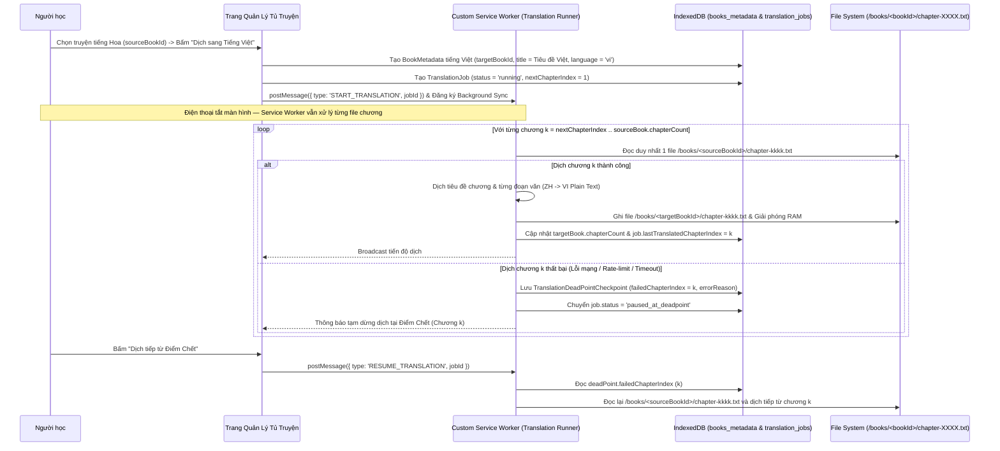

# Solution Architecture — EPIC-06: Dịch Truyện Chạy Ngầm (Tiếng Hoa $\rightarrow$ Tiếng Việt) bằng Service Worker & Phục Hồi Điểm Chết

* **Mã Epic:** EPIC-06
* **Tên Epic:** Service Worker Background Novel Translator (ZH $\rightarrow$ VI) & Dead-Point Resume
* **Trạng thái:** Chờ duyệt (Pending User Review)
* **Liên kết Tài liệu:** [BR-EPIC-06](file:///Users/sakutara/Work/chinese-study/documents/epics/epic-6-novel-translator/BR-EPIC-06.md) | [SA-MASTER](file:///Users/sakutara/Work/chinese-study/documents/SA-MASTER.md) | [ADR-006](file:///Users/sakutara/Work/chinese-study/documents/adr/ADR-006-opfs-chapter-file-storage-and-background-novel-translator.md)

---

## 1. Sơ đồ Tuần tự Dịch Truyện Ngầm Theo Từng File Chương & Phục Hồi Điểm Chết



---

## 2. Thiết kế Chi tiết các Module Kỹ thuật (`src/domains/translator/`)

### 2.1 Cấu trúc Dữ liệu Tiến trình Dịch & Điểm Chết (`src/domains/translator/types.ts`)
```ts
export type TranslationJobStatus =
  | 'idle'
  | 'running'
  | 'paused_at_deadpoint'
  | 'paused_by_user'
  | 'completed';

export interface TranslationDeadPointCheckpoint {
  failedChapterIndex: number;         // Thứ tự chương bị lỗi (1-based)
  lastTranslatedChapterIndex: number; // Chương cuối cùng đã ghi file thành công
  errorReason: string;                // Nguyên nhân lỗi
  failedAt: string;                   // ISO timestamp
  retryCount: number;
}

export interface TranslationJob {
  jobId: string;
  sourceBookId: string;               // ID bộ truyện tiếng Hoa gốc trong DB
  targetBookId: string;               // ID bộ truyện tiếng Việt đích trong DB
  sourceTitle: string;                // Tên truyện tiếng Hoa
  translatedTitle: string;            // Tên truyện tiếng Việt
  status: TranslationJobStatus;
  totalChapters: number;
  translatedChaptersCount: number;
  nextChapterIndex: number;           // Con trỏ chương tiếp theo cần dịch
  deadPoint?: TranslationDeadPointCheckpoint;
  updatedAt: string;
}
```

### 2.2 Bộ Dịch Câu & Chương Truyện Hoa $\rightarrow$ Việt (`ChineseToVietNovelTranslator.ts`)
* Hỗ trợ kiến trúc `ITranslationProvider` có thể hoán đổi hoặc kết hợp (Hybrid Offline + Online):
  1. **`translateBookTitle(zhTitle: string): Promise<string>`**:
     * Dịch tiêu đề bộ truyện tiếng Hoa sang tiếng Việt chuẩn (ví dụ: `"凡人修仙传"` $\rightarrow$ `"Phàm Nhân Tu Tiên Truyện"`, `"全职高手"` $\rightarrow$ `"Toàn Chức Cao Thủ"`, hoặc ghép nghĩa từ điển thông minh/Hán-Việt viết hoa chữ cái đầu nếu là tên riêng).
  2. **`translateChapterTitle(zhChapterTitle: string): Promise<string>`**:
     * Tự động chuyển đổi cấu trúc `"第X章 ..."` / `"第X节 ..."` sang `"Chương X: <Nghĩa tiếng Việt>"` (ví dụ: `"第一章 破防了"` $\rightarrow$ `"Chương 1: Phá phòng rồi (Vỡ trận cảm xúc)"`).
  3. **`translateParagraphs(zhParagraphs: string[]): Promise<string[]>`**:
     * Phân tách câu bằng `SmartSegmenter` (nhận diện từ kép, từ liên 3, thành ngữ 4 chữ, tiếng lóng, từ gốc Anh), kết hợp bộ quy tắc chuyển đổi ngữ pháp Trung-Việt (đảo cụm danh từ `A 的 B` $\rightarrow$ `B của A`, trợ từ thời thể `了/着/过`, đại từ nhân xưng tiểu thuyết `我/你/他/师兄/前辈`) hoặc gọi `customTranslateFetcher` (nếu cấu hình API dịch online), trả về các đoạn văn tiếng Việt thuần túy.

### 2.3 Bộ Điều Phối Dịch Chạy Ngầm & Quản Lý Điểm Chết (`NovelTranslationRunner.ts`)
* Chạy trong **Custom Service Worker** và giao tiếp trực tiếp với `BookFileSystemStore` + `StorageService`:
  * **`startOrResumeTranslation(jobId: string)`**:
    * Đọc `TranslationJob` và `sourceBookMetadata` từ DB.
    * Xác định chương bắt đầu: Nếu `job.status === 'paused_at_deadpoint'` và có `job.deadPoint`, lấy `startIdx = job.deadPoint.failedChapterIndex`; ngược lại lấy `startIdx = job.nextChapterIndex`.
    * Duyệt `chapterIdx` từ `startIdx` đến `sourceBookMetadata.chapterCount`:
      1. Đọc duy nhất file chương gốc: `const srcChapter = await fileStore.readChapterFile(job.sourceBookId, chapterIdx)`.
      2. Nếu không tìm thấy file chương gốc hoặc quá trình dịch ném lỗi:
         * Ghi nhận `TranslationDeadPointCheckpoint` với `failedChapterIndex = chapterIdx`, `lastTranslatedChapterIndex = chapterIdx - 1`, `errorReason`.
         * Cập nhật `job.status = 'paused_at_deadpoint'` vào DB và dừng vòng lặp an toàn.
      3. Dịch tiêu đề và nội dung đoạn văn sang tiếng Việt thuần (`Plain Text`).
      4. Ghi ra file chương đích: `await fileStore.writeChapterFile(job.targetBookId, { index: chapterIdx, title: viChapterTitle, paragraphs: viParagraphs })`.
      5. Cập nhật `targetBookMetadata` (thêm mục lục chương `chapterIdx`) và cập nhật `job.translatedChaptersCount = chapterIdx`, `job.nextChapterIndex = chapterIdx + 1`, xóa `deadPoint` cũ.
    * Khi hoàn thành chương cuối cùng, chuyển `job.status = 'completed'`.

---

## 3. Kế hoạch Kiểm thử & Ma trận Độ phủ ($\ge 90\%$ Coverage Plan)

| File Kiểm thử | Đối tượng được kiểm thử | Kịch bản kiểm thử chính (Test Cases) |
| :--- | :--- | :--- |
| `tests/novelTranslator.test.ts` | `ChineseToVietNovelTranslator` & `NovelTranslationRunner` | - Dịch tiêu đề truyện tiếng Hoa sang tiêu đề tiếng Việt, tạo bộ truyện tiếng Việt mới trong DB và thư mục `/books/<targetBookId>/`.<br>- Dịch lần lượt từng file chương từ `/books/<sourceBookId>/chapter-XXXX.txt` sang `/books/<targetBookId>/chapter-XXXX.txt` mà không nạp toàn bộ truyện vào RAM.<br>- Giả lập lỗi dịch ở chương 2 $\rightarrow$ kiểm tra trạng thái lưu `TranslationDeadPointCheckpoint` (`failedChapterIndex = 2`, `lastTranslatedChapterIndex = 1`).<br>- Gọi `resumeTranslation` $\rightarrow$ kiểm tra hệ thống dịch tiếp đúng từ chương 2 và hoàn thành chương 3.<br>- Xóa bộ truyện tiếng Việt ở trang Quản lý Tủ Truyện $\rightarrow$ xác minh toàn bộ thư mục `/books/<targetBookId>/` bị xóa sạch trong khi bộ truyện tiếng Hoa gốc vẫn nguyên vẹn. |
